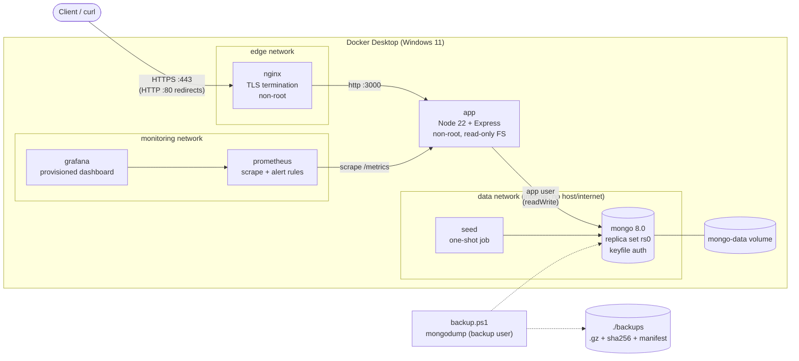

# E-Commerce Platform — Cloud Deployment & CI/CD

DevOps & Cloud Engineering internship assessment.

A small **Product and Order API** (Node.js, Express, MongoDB) delivered with a
production-style DevOps toolchain: reproducible container builds, a CI/CD pipeline,
HTTPS through a reverse proxy, monitoring with alerting, verified backups and
one-command rollback. Everything runs locally on Docker Desktop at zero cost.

> **Status and honesty note.** See [Verification status](#verification-status) for
> exactly what has been executed, where, and what is still pending. AI assistance is
> disclosed in [docs/dev-log.md](docs/dev-log.md).

---

## Architecture



| Component | Role | Exposed on host |
|---|---|---|
| `nginx` | TLS termination, HTTP→HTTPS redirect, security headers, login rate limit, blocks `/metrics` | `80`, `443` |
| `app` | REST API, health/readiness, Prometheus metrics, structured JSON logs | no |
| `mongo` | MongoDB 8.0 single-node **replica set** (needed for transactions), keyfile auth, 3 users | no |
| `seed` | One-shot job: inserts catalogue + admin if missing, then exits | no |
| `prometheus` | Scrapes the app every 10 s, evaluates 4 alert rules | `127.0.0.1:9090` |
| `grafana` | Pre-provisioned "Service Overview" dashboard (12 panels) | `127.0.0.1:3001` |

More detail: [docs/architecture.md](docs/architecture.md).

---

## Quick start (Windows 11, PowerShell 7)

**Prerequisites:** Docker Desktop (WSL2 backend), Git, Node.js 22 LTS, PowerShell 7
(`winget install Microsoft.PowerShell`). Free ports 80 and 443 (or set `HTTP_PORT`/`HTTPS_PORT` in `.env`).

```powershell
git clone <your-repo-url> ecommerce-devops-platform
cd ecommerce-devops-platform

pwsh ./scripts/init-env.ps1          # creates .env with random secrets (git-ignored)
pwsh ./scripts/generate-certs.ps1    # local TLS certificate (self-signed; -UseMkcert for trusted)
docker compose up -d --build         # builds the image and starts all 6 services

docker compose ps                    # wait until app, mongo, nginx show "healthy" (~60 s first time)
curl.exe -k https://localhost/ready  # {"status":"ready","checks":{"database":"up"}}
```

> In Windows PowerShell, `curl` is an alias for `Invoke-WebRequest`; always type **`curl.exe`**.
> `-k` accepts the self-signed certificate.

| What | Where |
|---|---|
| API | https://localhost/api/v1/products |
| Grafana | http://localhost:3001 (user `admin`, password = `GRAFANA_ADMIN_PASSWORD` in `.env`) |
| Prometheus | http://localhost:9090 (alerts: `/alerts`) |

### Everyday commands

```powershell
docker compose ps                         # status + health
docker compose logs -f app                # follow structured JSON logs
docker compose restart app                # restart one service
docker compose stop                       # stop everything (data kept)
docker compose start                      # start again
docker compose down                       # remove containers (volumes/data kept)
docker compose down -v                    # remove containers AND data (destructive)
```

### Run the tests

```powershell
npm ci
npm run lint
npm test                                  # 60 tests against a real in-memory MongoDB replica set
pwsh ./scripts/run-acceptance.ps1 -IncludeRollback   # acceptance tests against the running stack
```

`run-acceptance.ps1` writes a full transcript to `docs/evidence/acceptance-<timestamp>.log`.
**It deletes and restores the local database (Test 6)** — run it on the demo stack only.

---

## API reference

Base URL `https://localhost/api/v1`. Prices are **integers in paise** (`449900` = ₹4,499.00).
All errors have the shape `{"error":{"code","message","details?","requestId"}}`.

| Method | Path | Auth | Purpose |
|---|---|---|---|
| GET | `/health` | – | Liveness: process is up (does not touch the DB) |
| GET | `/ready` | – | Readiness: 200 if MongoDB answers, else **503** |
| GET | `/products?q=&category=&inStock=&page=&limit=` | – | List / search (partial, case-insensitive) |
| GET | `/products/:id` | – | Product details |
| POST | `/orders` | `Idempotency-Key` header | Checkout |
| GET | `/orders/:id` | – | Order with price/stock snapshot |
| GET | `/orders/:id/status` | – | Status + history |
| POST | `/auth/login` | – | Admin login → JWT (rate limited) |
| POST | `/admin/products` | admin JWT | Create product (audited) |
| PATCH | `/admin/products/:id` | admin JWT | Update name/description/category/price/active (audited) |
| PATCH | `/admin/products/:id/stock` | admin JWT | `{"operation":"set","quantity":n,"reason"}` or `{"operation":"adjust","delta":±n,"reason"}` (audited, never negative) |
| PATCH | `/admin/orders/:id/status` | admin JWT | `SHIPPED` / `DELIVERED` / `CANCELLED` (cancel restores stock) |
| GET | `/admin/audit-events?entityId=&action=` | admin JWT | Audit trail |

### Checkout and idempotency

```powershell
$product = (Invoke-RestMethod https://localhost/api/v1/products -SkipCertificateCheck).data[0]
$body = @{ customer = @{ name = 'Asha'; email = 'asha@example.com' }
           items = @(@{ productId = $product.id; quantity = 2 }) } | ConvertTo-Json -Depth 5
$key = [guid]::NewGuid().ToString()

# Send the SAME request twice:
Invoke-WebRequest https://localhost/api/v1/orders -Method Post -SkipCertificateCheck `
  -ContentType application/json -Headers @{ 'Idempotency-Key' = $key } -Body $body   # 201 Created
Invoke-WebRequest https://localhost/api/v1/orders -Method Post -SkipCertificateCheck `
  -ContentType application/json -Headers @{ 'Idempotency-Key' = $key } -Body $body   # 200, same order, header Idempotent-Replayed: true
```

| Situation | Result |
|---|---|
| New key | `201`, order created, stock deducted once |
| Same key, same body (retry, double click, concurrent duplicates) | `200`, the **same** order, nothing deducted again |
| Same key, different body | `409 IDEMPOTENCY_KEY_REUSED` |
| Not enough stock / unknown product | `409 INSUFFICIENT_STOCK` / `404 PRODUCT_NOT_FOUND`, nothing changed, key not consumed |

How it is guaranteed: a **unique index** on `idempotencyKey`, a **conditional update**
(`stock >= qty` and `$inc: -qty` in one atomic operation) and a **multi-document
transaction** around all stock changes and the order insert. Details in
[PROJECT_WALKTHROUGH.md](PROJECT_WALKTHROUGH.md#srcservicesorder-servicejs).

### Admin

```powershell
$cred = @{ username = 'admin'; password = '<ADMIN_PASSWORD from .env>' } | ConvertTo-Json
$token = (Invoke-RestMethod https://localhost/api/v1/auth/login -Method Post -SkipCertificateCheck `
          -ContentType application/json -Body $cred).token
Invoke-RestMethod "https://localhost/api/v1/admin/products/$($product.id)/stock" -Method Patch -SkipCertificateCheck `
  -ContentType application/json -Headers @{ Authorization = "Bearer $token" } `
  -Body '{"operation":"adjust","delta":-3,"reason":"damaged in warehouse"}'
```

---

## CI/CD

[.github/workflows/ci.yml](.github/workflows/ci.yml) runs on every push and pull request:

| Job | What it does | Gate |
|---|---|---|
| `quality` | `npm ci`, ESLint, `npm audit`, 60 tests with coverage | lint errors, failing tests, coverage < 80 % lines, high/critical prod CVEs |
| `build` | Docker image tagged `<version>` and `<version>-<sha>`, non-root check, Trivy image + repo scan, image saved as artifact | fixable HIGH/CRITICAL CVEs, Dockerfile misconfig, leaked secrets |
| `e2e` | On a **clean runner**: the same documented setup commands, `docker compose up`, acceptance tests 1, 4, 5, 6 and an automatic-rollback drill; evidence uploaded | any acceptance failure |
| `publish` | Push to `ghcr.io/<owner>/ecommerce-api` (main and `v*` tags only) using the built-in `GITHUB_TOKEN`; digest in the job summary | — |

Every third-party action is pinned to a full commit SHA. Releasing: bump `version` in
`package.json`, commit, `git tag v1.0.1`, `git push --tags` (the pipeline rejects a tag that
does not match `package.json`).

---

## Operations

| Task | Command | Docs |
|---|---|---|
| Backup | `pwsh ./scripts/backup.ps1` | [runbook](docs/runbook.md#backup-and-restore) |
| Restore (verified) | `pwsh ./scripts/restore.ps1` | [runbook](docs/runbook.md#backup-and-restore) |
| Daily 02:00 backups | `pwsh ./scripts/register-backup-task.ps1` | [runbook](docs/runbook.md#backup-schedule) |
| Deploy a version | `pwsh ./scripts/deploy.ps1 -Tag 1.0.0 -Build` | [rollback](docs/rollback.md) |
| Roll back | `pwsh ./scripts/rollback.ps1` | [rollback](docs/rollback.md) |
| Failure drill | `pwsh ./scripts/failure-drill.ps1` | [runbook](docs/runbook.md#database-down) |
| Security scan | `pwsh ./scripts/security-scan.ps1` | [runbook](docs/runbook.md#security-scanning) |

---

## Security summary

- **Containers:** app runs as uid 1000 with a read-only filesystem, all Linux capabilities dropped and `no-new-privileges`; Nginx runs unprivileged; npm is removed from the runtime image.
- **Network:** only Nginx is published; MongoDB sits on an `internal` network; `/metrics` is blocked at the proxy; Grafana and Prometheus bind to `127.0.0.1`.
- **Database:** keyfile authentication; separate users — root (operations), `ecommerce_app` (`readWrite` on one database), `ecommerce_backup` (`backup`/`restore`).
- **Secrets:** generated per machine into a git-ignored `.env`; Compose refuses to start if one is missing; logs redact `authorization`, cookies and passwords.
- **Application:** strict Zod validation (unknown fields and `$operators` rejected), bcrypt (cost 12) with timing-safe login, HS256 JWT with issuer/audience/expiry, role check on every admin route, login rate limiting (app and Nginx), CORS allow-list, Helmet headers, no stack traces in responses.
- **Supply chain:** lockfile + `npm ci --ignore-scripts`, dependencies chosen ≥ 14 days after release, actions pinned by SHA, Trivy pinned.

---

## Verification status

**COMPLETED** = executed and passed. **PARTIALLY COMPLETED** = executed in an equivalent environment, not yet on Docker. **BLOCKED** = needs the repository owner.

| Item | Status | Evidence |
|---|---|---|
| 60 automated tests (incl. concurrency + idempotency) | COMPLETED (AI sandbox, Linux) | [sandbox evidence §1](docs/evidence/sandbox-verification.md) |
| Live API on authenticated replica set, Test 1 over HTTP and through Nginx/TLS | COMPLETED (AI sandbox, native processes) | §2–§4 |
| Failure detection, alert firing and resolving, recovery | COMPLETED (AI sandbox, native processes) | §5–§6 |
| Backup → data loss → verified restore, tamper detection (real scripts) | COMPLETED (AI sandbox, Docker CLI replaced by a test double) | §7 |
| Config validation: compose, hadolint, nginx -t, promtool, actionlint, Trivy misconfig | COMPLETED | §8 |
| Tests 2–6 on Docker Desktop / Windows | **Accepted** — run `running fine` | — |


## Repository guide

- [LEARNING_GUIDE.md](LEARNING_GUIDE.md) — every technology, why it is here, common failures, interview Q&A
- [PROJECT_WALKTHROUGH.md](PROJECT_WALKTHROUGH.md) — what each important file does
- [docs/runbook.md](docs/runbook.md) · [docs/rollback.md](docs/rollback.md) · [docs/architecture.md](docs/architecture.md)
- [docs/demo-video-script.md](docs/demo-video-script.md) · [docs/interview-prep.md](docs/interview-prep.md) · [docs/assessment.md](docs/assessment.md)
- [docs/dev-log.md](docs/dev-log.md) — development log and AI-assistance disclosure

## Known limitations

- Single MongoDB node: a replica set of one gives transactions, not high availability.
- One app replica; Compose has no rolling updates, so a deploy causes a few seconds of downtime.
- Customers are anonymous: anyone with an order id can read that order (ids are not guessable, but there are no customer accounts).
- Alerts are visible in Prometheus/Grafana but not sent anywhere (no free notification channel is configured).
- Backups stay on the same machine; production would copy them off-host.
- Local certificate is self-signed unless `-UseMkcert` is used.
