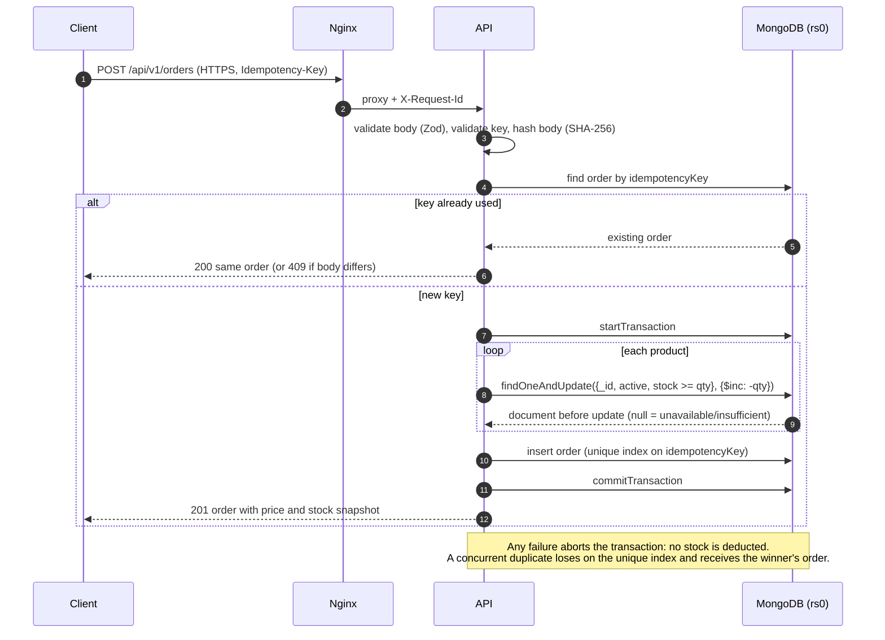

# Architecture

The component diagram is in the [README](../README.md#architecture). This document covers
the request flow, the data model and the main design decisions.

## Checkout request flow

## Data model

| Collection | Key fields | Indexes |
|---|---|---|
| `products` | `sku`, `name`, `category`, `price` (int, paise), `stock` (int ≥ 0), `active` | `sku` unique, `category` |
| `orders` | `idempotencyKey`, `requestHash`, `customer`, `items[]` (snapshot), `totalAmount`, `status`, `statusHistory[]` | `idempotencyKey` **unique** |
| `auditevents` | `actor`, `action`, `entityType`, `entityId`, `before`, `after`, `reason`, `requestId`, `createdAt` | `action`, `entityId`, `createdAt` |
| `adminusers` | `username`, `passwordHash` (bcrypt), `role` | `username` unique |

Order item snapshot: `productId, sku, name, unitPrice, quantity, lineTotal,
stockAtCheckout, stockAfterCheckout` — later product edits never change past orders.

Order states: `CONFIRMED → SHIPPED → DELIVERED`, `CONFIRMED → CANCELLED` (restores stock).

## Design decisions

| # | Decision | Why | Alternative rejected |
|---|---|---|---|
| 1 | MongoDB as a **single-node replica set** | Multi-document transactions (all stock decrements + order insert, or nothing) require a replica set | Standalone mongod: no transactions → half-placed orders possible |
| 2 | Idempotency via **unique index** + request hash | The database enforces "one order per key" even when two requests race; the hash detects key reuse with a different body | In-memory/app-level check only: two concurrent requests both pass the check |
| 3 | Conditional `$inc` instead of read-then-write | `stock >= qty` and the decrement are one atomic operation → no negative stock under concurrency | Read stock, compare, save: a race lets two buyers take the last unit |
| 4 | Money as **integer paise** | Floats cannot represent amounts like 0.1 exactly | `Number` rupees with decimals |
| 5 | `/health` (liveness) separate from `/ready` (readiness) | A DB outage should not get the app container killed; it should be reported as "not ready" | One endpoint for both |
| 6 | Only Nginx published; Mongo on an **internal** network | Smallest attack surface; the DB has no route to the host or internet | Publishing 27017 for convenience |
| 7 | Three DB users (root, app, backup) | Least privilege: a leaked app credential cannot drop other databases or read users | App connects as root |
| 8 | Images **versioned and immutable**; tag in `.env` | Rollback = run the previous image; nothing is rebuilt under pressure | `latest` tag / rebuilding old commits |
| 9 | Seed as a **one-shot Compose job** | Startup order is explicit (`service_completed_successfully`); re-runnable without resetting stock | Seeding inside app startup |
| 10 | Backups via `mongodump` + checksum + manifest | Archives are verifiable; restore proves counts match | Copying the volume while mongod runs (inconsistent) |
| 11 | Ops scripts in **PowerShell 7** | Same scripts run on the owner's Windows machine and on Linux CI runners | Separate Bash and PowerShell versions |
| 12 | No Kubernetes / Terraform | The brief is local, zero-budget deployment; Compose covers it and stays explainable | Over-engineering for the scope |

## Scaling path (not implemented)

Three-member replica set for availability; several app replicas behind Nginx (the API
is stateless — JWTs, no sessions); backups shipped off-host; Alertmanager for
notifications; a managed database and container platform in a real cloud.
